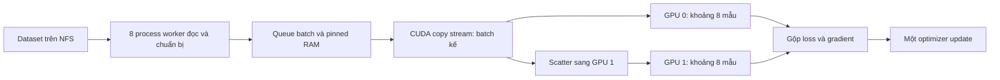

# Học cách CPU đa nhân phối hợp với GPU trong ACT

## Bài 1 — Phân biệt những thứ đang đếm

| Khái niệm | Nghĩa | Trong lượt mới |
|---|---|---|
| Slurm job | Một lần xin tài nguyên và chạy script | Một job có 2 GPU |
| CPU được cấp | Khả năng CPU scheduler dành cho job; có thể là logical CPU | 16 |
| Process | Chương trình với không gian bộ nhớ riêng | Main Python + DataLoader worker |
| Thread | Luồng thực thi trong cùng process | Thư viện native, pinning, DataParallel |
| Worker | Process chuyên gọi Dataset/chuẩn bị batch | 8 khi loader đang chạy |
| Batch | Nhóm mẫu cho một optimizer update | Tổng 16 |
| GPU | Thiết bị thực hiện phép toán tensor | 2, mỗi chiếc khoảng 8 mẫu |

`--ntasks=1` là một Slurm task; process đó được phép tạo process con. Không cần đăng ký thêm tám job để có tám worker. Số worker không đồng nghĩa số GPU hay số mẫu của batch. [Slurm sbatch](https://slurm.schedmd.com/sbatch.html).

CPU 100% trong `top` thường xấp xỉ một logical CPU dùng hết. Dashboard chuẩn hóa theo allocation: dùng tổng 200% trên 16 CPU tương đương khoảng 12,5%. CPU thấp vẫn hợp lý khi phần nặng ở GPU; không đặt mục tiêu CPU/GPU phải cùng 100%.

**Bài tập:** đọc header sbatch. Tìm `ntasks`, `cpus-per-task`, `gres`, `mem`. Sau đó tìm batch/worker trong log startup. Viết lại bốn số này bằng lời của bạn.

## Bài 2 — Process và thread trong Python

Ở CPython 3.12 thông thường, GIL hạn chế nhiều thread cùng chạy bytecode Python CPU-bound. Multiprocessing dùng nhiều interpreter/process, tránh giới hạn đó. Process có chi phí startup và truyền dữ liệu; chia công việc quá nhỏ có thể chậm hơn tuần tự. NumPy/PyTorch native có thể nhả GIL; thread cũng hữu ích khi chờ I/O. [Python multiprocessing 3.12](https://docs.python.org/3.12/library/multiprocessing.html).

Đọc các phần `Process`, `Pool`, `Queue`, `spawn` trong tài liệu trên. Học ba yêu cầu:

1. Hàm mà process mới dùng nên được định nghĩa ở cấp module, có thể import/pickle.
2. Đặt entry point dưới `if __name__ == '__main__':` để tránh spawn lặp.
3. Với `spawn`, worker là interpreter mới. Không cho worker giữ CUDA model hoặc thực hiện optimizer step.

**Bài tập:** dùng `ProcessPoolExecutor(max_workers=2)` tính tổng bình phương cho tám dãy số vừa phải; so kết quả với vòng lặp tuần tự. Đo cả startup. Tăng kích thước mỗi công việc rồi quan sát khi nào process pool có lợi. Chạy bài CPU này trên compute node qua sbatch, không chạy code nặng trên head node.

## Bài 3 — Worker đang làm gì?

Trong dự án, main process tạo thứ tự sample từ `EpisodeShuffleSampler`. Worker đọc sample từ dataset/memmap, chuyển đổi và ghép batch; main nhận batch theo thứ tự loader. GPU mới forward/backward. Worker không tự học hay tự chọn nhãn khác.

`num_workers=8` cho phép nhiều batch được chuẩn bị đồng thời. `prefetch_factor=2` cho phép tối đa khoảng **16 task batch được đưa vào pipeline**; không bảo đảm cả 16 đã sẵn sàng. `persistent_workers=True` giữ worker qua các epoch, giảm startup. `pin_memory=True` hỗ trợ chuyển CPU→GPU. [DataLoader 2.7](https://docs.pytorch.org/docs/2.7/data.html).

Hai loader train/val riêng giữ worker persistent: có thể thấy hai nhóm 8 process tồn tại sau khi cả hai loader khởi động. Số process tồn tại không có nghĩa cả hai nhóm đều đang đọc dữ liệu liên tục. `resource_tracker` là tiến trình hỗ trợ, không tính như DataLoader worker.

**Bài tập:** mở `src/training/pretrain.py`, đọc `make_loader`. Giải thích từng đối số trên. Quan sát PID/PPID của main và các `spawn_main` trên node job. Đừng đếm các dòng `grep`/`bash` là worker.

## Bài 4 — Tránh quá nhiều thread tranh CPU

Giả sử 8 worker và mỗi worker cho BLAS dùng 8 thread: đã có thể tạo 64 thread tính toán trên allocation 16 CPU. Context switching và tranh tài nguyên có thể làm throughput giảm.

Script đặt:

```bash
export OMP_NUM_THREADS=1 MKL_NUM_THREADS=1 OPENBLAS_NUM_THREADS=1
```

Như vậy các thư viện đó hạn chế thread nội bộ; nhiều worker vẫn chạy song song. Đây không phải cấm main hoặc PyTorch tạo thread hỗ trợ. Đọc mục CPU threading trong [PyTorch tuning guide](https://docs.pytorch.org/tutorials/recipes/recipes/tuning_guide.html).

**Bài tập:** giữ batch cố định và so worker 2/4/8 trong những lượt benchmark ngắn. Ghi CPU tổng, RAM, `data_wait_ms`, `samples_per_s`. Chọn theo tốc độ và ổn định, không chỉ theo số worker cao nhất. NFS dùng chung cũng có giới hạn I/O.

## Bài 5 — Pipeline giúp GPU ít phải chờ



Pinned memory là RAM CPU được khóa trang, không phải VRAM. `non_blocking=True` tránh main phải chờ ngay sau mỗi lệnh copy khi điều kiện cho phép. Copy stream riêng có thể chồng chuyển batch kế với compute hiện tại; cần đồng bộ đúng trước khi dùng tensor. Không phải mọi phép copy đều tự biến mất hoặc mọi kernel đều chạy đồng thời. [Pinned memory và non_blocking](https://docs.pytorch.org/tutorials/intermediate/pinmem_nonblock.html).

Trong log user đã đo, `data_wait_ms≈0,2–0,8`, `step_ms≈244` ở batch 4. CPU→GPU đo riêng khoảng 4,45 ms. Đây là căn cứ cho thấy tăng worker nữa lúc đó khó đem lại cải thiện lớn; step còn gồm compute và đồng bộ scalar. Sau đổi batch/GPU phải đo lại.

Batch 16 có payload ảnh/state/action khoảng bốn lần batch 4 nếu dtype/shape giữ nguyên: 84,38 MiB × 4 ≈ 337,52 MiB. Payload lớn hơn không tự chứng minh train nhanh hơn; dùng mẫu/giây và thời gian epoch để so.

## Bài 6 — Nhiều GPU và giới hạn batch

DataParallel chia batch theo chiều đầu của tensor, chạy các replica rồi cộng gradient về model gốc. Batch tổng 16 trên hai GPU thường là 8+8. Batch cuối train 9 mẫu là 5+4. Adapter gộp L1 theo số action elements thật, KL theo số mẫu; trung bình hai loss không có trọng số có thể sai vì padding khác nhau. [DataParallel 2.7](https://docs.pytorch.org/docs/2.7/generated/torch.nn.DataParallel.html).

Mỗi GPU cần bản model và activation riêng. Hai A100 80 GB không tự biến thành một GPU có VRAM 160 GB cho mọi tensor. GPU 0 của phương án hiện tại còn giữ optimizer và điểm gộp, nên bộ nhớ có thể không cân bằng. DDP dùng process/GPU riêng và thường là hướng tối ưu tiếp theo; hiện tại gói dùng DataParallel để tích hợp trainer/checkpoint đang có.

**Bài tập:** với 58.313 sample, tính số batch cho size 4, 16, 32: lần lượt 14.579, 3.645, 1.823. Giải thích vì sao ít optimizer update hơn mỗi epoch không đồng nghĩa chất lượng y hệt. Theo dõi val và lưu best sau khi đổi batch.

## Bài 7 — Đọc phép đo đúng

| Phép đo | Trả lời câu hỏi |
|---|---|
| `data_wait_ms` | Main chờ loader/prefetch bao lâu? |
| `step_ms` | Chuyển còn lại + model/update + scalar sync tốn bao lâu? |
| `samples_per_s` | Lượt đang xử lý nhanh đến đâu? |
| GPU utilization | GPU bận trong cửa sổ lấy mẫu tới mức nào? |
| VRAM reserved/allocated | Bộ nhớ GPU có đang gần giới hạn? |
| Train/val loss | Mô hình đang học và tổng quát hóa thế nào? |
| Train + val epoch time | Mất bao lâu để hoàn thành một lượt dữ liệu? |

Đừng dùng riêng GPU 100% để kết luận cấu hình tốt nhất. Hai GPU có trao đổi dữ liệu và replicate model; có thể nhanh chưa tới hai lần, thậm chí chậm hơn với batch nhỏ. Đo cửa sổ ổn định sau startup và lưu config, seed, GPU, batch, workers cùng kết quả.

Lộ trình: hiểu process/thread → chạy bài CPU nhỏ → đọc Dataset/DataLoader → hiểu pinned/streams → đọc adapter multi-GPU → so benchmark → dùng profiler khi còn nút thắt cụ thể. Chưa cần tăng mọi tài nguyên cùng lúc để học được cách tối ưu.
